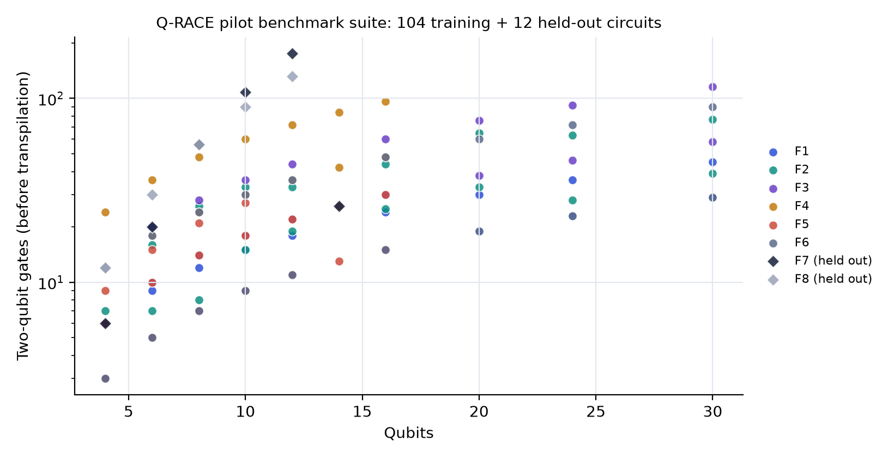

# Checkpoint 1: acceptance evidence for D1.1 and D1.2

This file records how each "done when…" condition of the Checkpoint-1 deliverables
was checked. Laptop and CI results come from the project log (`LOG.md`); *local*
numbers come from a clean Linux machine (25 November 2026, after the F7 update).

## D1.1 Repository, CI, README, licence, pinned environment

**Done when:** CI is green; a fresh clone installs in < 15 min.

| Check | Evidence | Result |
|---|---|---|
| Package skeleton | `src/qrace` (src layout), `pyproject.toml`, console script `qrace-bench`; planned modules (`arms`, `run`, `features`, `noise`, `data`, `models`, `select`, `eval`) present as documented stubs with import tests | ✅ |
| Pinned environment | `requirements.lock`: universal lock from `uv pip compile` (Python 3.11 and 3.12, Linux/macOS/Windows) | ✅ |
| Fresh clone install, Windows laptop | Python 3.12, `pip install -r requirements.lock`: 2 min 47 s (limit 15 min); repeated on a second Windows laptop | ✅ |
| Fresh install, no cache (*local*) | Linux, Python 3.12: 84 s | ✅ |
| CI | `.github/workflows/ci.yml`: tests on Ubuntu (Python 3.11, 3.12) and Windows (Python 3.12) | ✅ green · ☐ add run link |
| HPC | same `requirements.lock` on the institute cluster | ☐ add HPC run log |
| README and licence | install instructions, repository layout; Apache-2.0 (`LICENSE`, declared in `pyproject.toml`) | ✅ |
| Hygiene | `.gitignore` blocks IBM tokens (`.env`, `qiskit-ibm.json`); drafts of `DATA_CARD.md` and `PREREGISTRATION.md` | ✅ |

## D1.2 Benchmark suite F1–F8 with Clifford twins and exact ideal values

**Done when:** tests confirm ideal values against a state vector for ≤ 10 qubits.

| Check | Evidence | Result |
|---|---|---|
| Eight families implemented | `qrace.bench.families`: F1–F8 with every variant and parameter value used by the suite grids (41 settings) | ✅ |
| Exact ideal values | stabilizer (F1, F2, F6, twins), state vector (F4, F5, F7, F8), analytic (F3) | ✅ |
| **Acceptance test** (*local*) | `tests/test_ideal_values.py`: **985 tests**. All 41 family settings × n ∈ {4, 6, 8, 10} (even n only where required) × 3 seeds, for the circuits and for their Clifford twins, against an independent dense state vector, tolerance 10⁻⁹ | ✅ 985/985 pass |
| Pilot suite re-verification (*local*) | `qrace-bench verify`: 61 instances with n ≤ 10, 455 observables, max deviation 1.4 × 10⁻¹⁴ | ✅ |
| Clifford twins | same instruction count, same two-qubit gates on the same qubits, same barriers; Clifford by construction; ≥ 1 observable with ideal ±1 (`tests/test_twins.py`) | ✅ |
| Wide circuits | 30-qubit F1, F2, F6 via the stabilizer route; F3 analytic values match the state vector at 16 qubits (`tests/test_wide.py`) | ✅ |
| F7 regimes | three tilted-field regimes (angles of the AI-QEM Ising benchmarks) plus the pure transverse-field Ising regime; all four appear in the pilot suite (`tests/test_families.py`, `tests/test_suite.py`) | ✅ |
| Determinism | pilot `circuits.qpy` SHA-256 `17b4dfd911c691a0…`, identical across repeated runs and across Python 3.11 and 3.12 | ✅ |
| Held-out discipline | F7, F8 (and their twins) carry `split = "heldout"` (tested) | ✅ |
| Whole test suite (*local*) | 1,310 passed, 1 skipped (by design), Python 3.11 and 3.12 | ✅ |

## Pilot suite (input to the D1.5 pilot dataset)



See [`pilot_summary.md`](pilot_summary.md) for the per-family table.

## How to reproduce this evidence

```bash
python -m venv .venv
.venv\Scripts\activate                      # macOS/Linux: source .venv/bin/activate
pip install -r requirements.lock
pip install -e . --no-deps
pytest -q                                   # whole suite
pytest -q tests/test_ideal_values.py        # D1.2 acceptance test only
qrace-bench build --spec pilot --out data/bench/pilot
qrace-bench verify data/bench/pilot --max-qubits 10
```

The SHA-256 of `data/bench/pilot/circuits.qpy` should start with `17b4dfd911c691a0`
(PowerShell: `Get-FileHash data\bench\pilot\circuits.qpy`).
